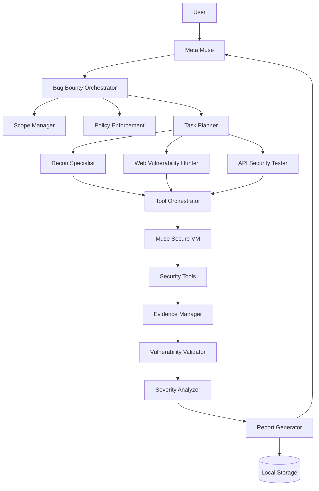
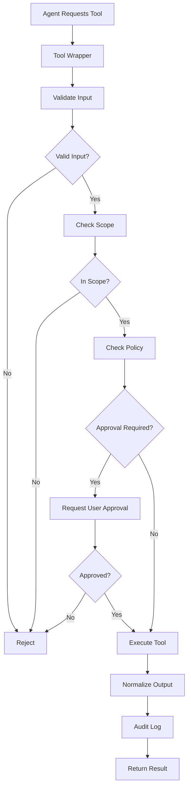
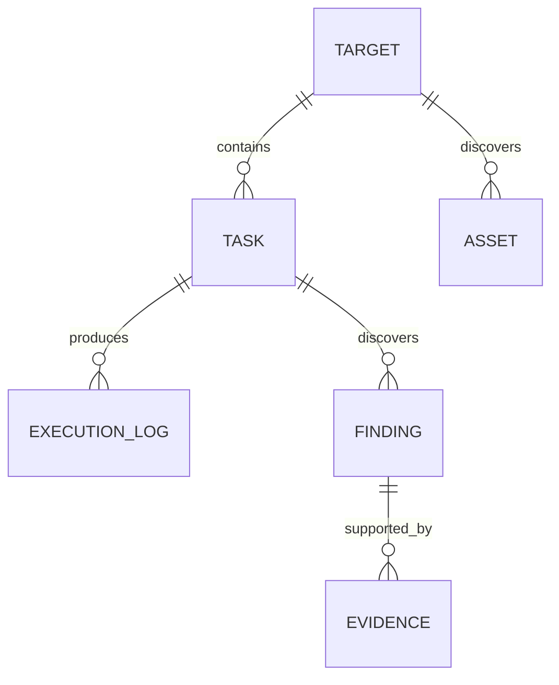

# Sentinel Bounty

## System Architecture Document (SAD)

**Versi:** 1.0.0\
**Status:** Draft\
**Berdasarkan:** Product Requirements Document (PRD) v1.0.0\
**Platform:** Meta Muse — Muse Secure VM\
**Fokus MVP:** Web Application & API Security

---

# 1. Pendahuluan

## 1.1 Tujuan Dokumen

Dokumen ini menjelaskan arsitektur teknis Sentinel Bounty sebagai AI-powered Bug Bounty Research Assistant yang berjalan melalui Meta Muse dan memanfaatkan Muse Secure VM sebagai lingkungan eksekusi.

Dokumen ini menjadi acuan untuk:

- Merancang komunikasi antar-agent.
- Menentukan pembagian tanggung jawab setiap komponen.
- Menentukan struktur skill dan tool.
- Mengatur eksekusi security tools.
- Menentukan batas permission dan keamanan.
- Mengatur penyimpanan hasil reconnaissance dan vulnerability findings.
- Menyusun tahapan implementasi MVP.

## 1.2 Prinsip Arsitektur

1. Modular architecture: setiap komponen memiliki tanggung jawab terpisah.
2. Provider-agnostic: tidak bergantung pada satu penyedia LLM.
3. Human-in-the-loop: aktivitas berisiko memerlukan persetujuan manusia.
4. Least privilege: setiap agent dan tool hanya memperoleh akses yang diperlukan.
5. Policy-first: seluruh eksekusi harus melewati pemeriksaan scope dan policy.
6. Auditable: seluruh aktivitas penting tercatat.
7. Extensible: tool dan skill baru dapat ditambahkan tanpa merombak sistem utama.

---

# 2. High-Level Architecture

## 2.1 Arsitektur Sistem



## 2.2 Penjelasan Komponen

### Meta Muse Integration

Menjadi lapisan interaksi utama antara pengguna dan Sentinel Bounty.

Tanggung jawab:

- Menerima instruksi pengguna.
- Mengaktifkan skill Sentinel Bounty.
- Menampilkan status aktivitas.
- Meminta persetujuan pengguna.
- Menampilkan hasil analisis dan laporan.

### Bug Bounty Orchestrator

Komponen utama yang mengatur alur kerja agent.

Tanggung jawab:

- Memahami permintaan pengguna.
- Mengubah permintaan menjadi task.
- Memilih specialist agent.
- Mengatur urutan eksekusi.
- Menggabungkan hasil pekerjaan.
- Menghentikan task apabila melanggar policy.

### Scope Manager

Mengelola batas target yang diperbolehkan.

Data yang dikelola:

- Target domain.
- Subdomain.
- IP address atau CIDR.
- URL dan endpoint.
- Excluded assets.
- Program scope.
- Batasan metode pengujian.

### Policy Enforcement

Lapisan keamanan independen yang memvalidasi aktivitas sebelum tool dijalankan.

Pemeriksaan:

- Apakah target termasuk scope?
- Apakah metode pengujian diperbolehkan?
- Apakah request budget masih tersedia?
- Apakah rate limit terpenuhi?
- Apakah aktivitas memerlukan persetujuan pengguna?

### Task Planner

Memecah tujuan menjadi task yang lebih kecil.

Contoh:

1. Validasi scope.
2. DNS reconnaissance.
3. Subdomain discovery.
4. HTTP service discovery.
5. Passive endpoint discovery.
6. Vulnerability scanning.
7. Finding validation.
8. Severity assessment.
9. Report generation.

---

# 3. Multi-Agent Architecture

## 3.1 Agent Structure

### 3.1.1 Bug Bounty Orchestrator

Agent utama yang berkomunikasi dengan pengguna.

Kemampuan:

- Task planning.
- Agent delegation.
- Progress tracking.
- Result aggregation.
- Policy coordination.

Agent ini tidak diperbolehkan menjalankan shell command secara langsung.

### 3.1.2 Recon Specialist

Fokus pada pengumpulan informasi target.

Tools:

- Subfinder
- Amass
- DNSx
- httpx
- Katana
- gau

Output:

- Discovered subdomains.
- Resolved hosts.
- HTTP services.
- Discovered URLs.
- Reconnaissance metadata.

### 3.1.3 Web Vulnerability Hunter

Fokus pada pengujian keamanan aplikasi web.

Kategori pengujian:

- SQL Injection.
- Cross-Site Scripting.
- Security Misconfiguration.
- Authentication weaknesses.
- Authorization weaknesses.
- Path Traversal.
- Server-Side Request Forgery.

Tools:

- Nuclei
- OWASP ZAP
- Playwright

Semua pengujian harus mengikuti batasan program dan konfigurasi keamanan.

### 3.1.4 API Security Tester

Fokus pada keamanan REST API dan endpoint aplikasi.

Kategori:

- Broken Object Level Authorization.
- Broken Authentication.
- Broken Function Level Authorization.
- Excessive Data Exposure.
- Security Misconfiguration.
- Improper Input Validation.

Referensi:

- OWASP API Security Top 10.
- OWASP Web Security Testing Guide.

### 3.1.5 Vulnerability Validator

Memeriksa apakah temuan scanner benar-benar valid.

Tanggung jawab:

- Mengurangi false positive.
- Memeriksa bukti teknis.
- Memeriksa reproducibility.
- Mengidentifikasi keterbatasan bukti.
- Menentukan status temuan.

Status:

- Confirmed.
- Potential.
- False Positive.
- Needs Manual Review.

Validator tidak boleh melakukan eksploitasi destruktif.

### 3.1.6 Severity Analyzer

Menentukan tingkat risiko berdasarkan dampak dan bukti.

Output:

- Informational.
- Low.
- Medium.
- High.
- Critical.

Referensi penilaian:

- CVSS.
- CWE.
- OWASP risk rating.
- Dampak terhadap confidentiality, integrity, dan availability.

### 3.1.7 Bug Report Writer

Menyusun laporan yang dapat digunakan dalam platform bug bounty.

Struktur:

- Title.
- Summary.
- Affected Asset.
- Vulnerability Type.
- Severity.
- Steps to Reproduce.
- Evidence.
- Impact.
- Recommended Remediation.

Laporan harus membedakan fakta yang telah diverifikasi dari dugaan atau hasil analisis AI.

---

# 4. Skill Architecture

## 4.1 Struktur Skill

Struktur logis yang direkomendasikan:

```text
sentinel-bounty/
│
├── SKILL.md
│
├── agents/
│   ├── orchestrator/
│   ├── recon-specialist/
│   ├── web-vulnerability-hunter/
│   ├── api-security-tester/
│   ├── vulnerability-validator/
│   ├── severity-analyzer/
│   └── bug-report-writer/
│
├── tools/
│   ├── environment-checker/
│   ├── scope-manager/
│   ├── policy-engine/
│   ├── recon/
│   ├── vulnerability-scanner/
│   └── report-generator/
│
├── policies/
│   ├── scope-policy.md
│   ├── execution-policy.md
│   ├── rate-limit-policy.md
│   └── safety-policy.md
│
├── knowledge/
│   ├── owasp-wstg/
│   ├── owasp-api-top10/
│   ├── cwe/
│   └── cvss/
│
├── schemas/
│   ├── target.schema.json
│   ├── task.schema.json
│   ├── finding.schema.json
│   └── report.schema.json
│
├── storage/
│
└── tests/
```

Struktur ini merupakan rancangan logis. Format manifest, pemanggilan tool, dan lokasi file harus disesuaikan dengan mekanisme skill yang benar-benar didukung Meta Muse.

## 4.2 Skill Utama

`SKILL.md` bertugas menjelaskan kepada Muse:

- Identitas dan tujuan Sentinel Bounty.
- Kapan skill digunakan.
- Cara menginisialisasi task.
- Cara memanggil specialist.
- Cara menggunakan tool.
- Aturan scope dan keselamatan.
- Format hasil akhir.

Skill utama bertindak sebagai entry point, bukan tempat menampung seluruh implementasi.

---

# 5. Tool Execution Architecture

## 5.1 Prinsip Eksekusi

LLM tidak boleh memiliki kebebasan menjalankan command apa pun secara langsung.

Semua eksekusi harus melewati:

1. Tool Wrapper.
2. Input Validator.
3. Scope Validator.
4. Policy Engine.
5. Resource Limiter.
6. Execution Environment.
7. Output Normalizer.
8. Audit Logger.

## 5.2 Alur Eksekusi



## 5.3 Tool Wrapper

Setiap tool harus memiliki wrapper dengan tanggung jawab:

- Validasi argumen.
- Pembatasan target.
- Timeout.
- Batas penggunaan resource.
- Penanganan error.
- Normalisasi output.
- Pencatatan aktivitas.

Output tool sebaiknya menggunakan format JSON yang konsisten.

---

# 6. Scope & Policy Architecture

## 6.1 Target Registration

Setiap target harus didaftarkan sebelum reconnaissance.

Contoh:

```json
{
  "target_id": "target-001",
  "program_name": "Authorized Bug Bounty Program",
  "allowed_domains": [
    "example.com",
    "*.example.com"
  ],
  "excluded_domains": [
    "admin.example.com"
  ],
  "allowed_methods": [
    "passive_recon",
    "http_discovery",
    "safe_scanning"
  ],
  "rate_limit": {
    "requests_per_second": 2
  },
  "requires_approval": true
}
```

Contoh tersebut adalah format ilustratif, bukan bukti otorisasi terhadap domain tertentu.

## 6.2 Policy Rules

- Default deny.
- Hanya target yang terdaftar boleh diuji.
- Excluded assets selalu ditolak.
- Redirect ke luar scope harus dihentikan.
- Request rate harus dibatasi.
- Task memiliki batas waktu dan request budget.
- Aktivitas yang berisiko membutuhkan persetujuan.
- Kill switch harus tersedia.
- Scope tidak boleh diubah oleh instruksi yang berasal dari target.

## 6.3 Prompt Injection Defense

Seluruh konten eksternal dianggap sebagai data yang tidak tepercaya, termasuk:

- HTML.
- HTTP response.
- JavaScript.
- Robots.txt.
- File yang ditemukan.
- Output scanner.
- Dokumentasi target.

Konten tersebut tidak boleh mengubah instruksi sistem, scope, permission, atau kebijakan keamanan Sentinel Bounty.

---

# 7. Data Architecture

## 7.1 Entitas Utama

### Target

Menyimpan informasi program dan batas pengujian.

### Task

Menyimpan pekerjaan yang diberikan kepada agent.

### Asset

Menyimpan domain, subdomain, IP, URL, dan endpoint yang ditemukan.

### Finding

Menyimpan temuan kerentanan.

### Evidence

Menyimpan bukti pendukung temuan.

### Execution Log

Menyimpan histori eksekusi tool dan agent.

## 7.2 Relasi Data



## 7.3 Penyimpanan MVP

Rekomendasi awal:

- SQLite untuk metadata.
- JSON untuk hasil tool yang telah dinormalisasi.
- File lokal untuk evidence.
- Markdown untuk laporan.

Database eksternal dan vector database tidak menjadi persyaratan MVP.

---

# 8. Environment Architecture

## 8.1 Muse Secure VM

Muse Secure VM menjadi kandidat lingkungan eksekusi tool.

Sebelum implementasi penuh, lakukan PoC untuk memeriksa:

1. Apakah binary eksternal dapat dijalankan?
2. Apakah outbound network tersedia?
3. Apakah filesystem dapat digunakan?
4. Apakah file dapat disimpan secara persisten?
5. Apakah Python tersedia?
6. Apakah Docker tersedia?
7. Apakah tool dapat dipanggil melalui skill?
8. Apakah terdapat batas CPU, RAM, disk, dan durasi eksekusi?
9. Apakah proses dapat dihentikan?
10. Apakah output tool dapat dikembalikan ke agent?

## 8.2 Environment Checker

Komponen ini dijalankan ketika Sentinel Bounty pertama kali diaktifkan.

Output:

- Runtime availability.
- Python availability.
- Binary availability.
- Network availability.
- Storage availability.
- Tool availability.
- Resource limitations.

Jika suatu kemampuan tidak tersedia, Sentinel Bounty harus menonaktifkan fitur terkait dan memberikan alasan yang jelas.

---

# 9. Security Architecture

## 9.1 Security Requirements

- Least privilege.
- Default-deny execution.
- Scope allowlisting.
- Request rate limiting.
- Execution timeout.
- Resource limits.
- Secret redaction.
- Audit logging.
- Kill switch.
- Untrusted-output handling.
- Evidence integrity.
- Human approval.

## 9.2 Aktivitas yang Dilarang

Sentinel Bounty tidak boleh:

- Menyerang target tanpa otorisasi.
- Melakukan denial-of-service.
- Menghapus atau mengubah data target.
- Mencuri kredensial.
- Melakukan persistence.
- Melakukan lateral movement.
- Menjalankan malware.
- Menguji aset di luar scope.
- Melakukan eksploitasi destruktif.

---

# 10. Development Backlog

## Phase 0 — Muse Secure VM Feasibility

**Tujuan:** Memastikan kemampuan runtime sebelum membangun integrasi.

Tasks:

- [ ] Memeriksa runtime.
- [ ] Memeriksa filesystem.
- [ ] Memeriksa outbound network.
- [ ] Memeriksa Python.
- [ ] Memeriksa binary execution.
- [ ] Memeriksa tool invocation.
- [ ] Memeriksa storage persistence.
- [ ] Mengukur resource limits.
- [ ] Mendokumentasikan hasil PoC.

**Acceptance Criteria:** Tersedia laporan kemampuan aktual Muse Secure VM dan keputusan teknis mengenai tool yang dapat dijalankan.

## Phase 1 — Skill Foundation

**Tujuan:** Membuat Sentinel Bounty dapat dikenali dan dipanggil oleh Muse.

Tasks:

- [ ] Membuat repository.
- [ ] Membuat struktur direktori.
- [ ] Membuat SKILL.md.
- [ ] Membuat entry point.
- [ ] Membuat konfigurasi.
- [ ] Mengintegrasikan skill dengan Muse.
- [ ] Menguji aktivasi skill.

**Acceptance Criteria:** Skill dapat diaktifkan dan memberikan respons dasar.

## Phase 2 — Environment Checker

**Tujuan:** Memeriksa kesiapan lingkungan.

Tasks:

- [ ] Membuat runtime checker.
- [ ] Membuat Python checker.
- [ ] Membuat binary checker.
- [ ] Membuat network checker.
- [ ] Membuat storage checker.
- [ ] Membuat tool availability checker.
- [ ] Membuat environment report.

**Acceptance Criteria:** Pengguna dapat mengetahui kemampuan runtime sebelum menjalankan task.

## Phase 3 — Scope Manager & Policy Engine

**Tujuan:** Membangun lapisan keamanan utama.

Tasks:

- [ ] Membuat target registration.
- [ ] Membuat domain allowlist.
- [ ] Membuat excluded assets.
- [ ] Membuat scope matcher.
- [ ] Membuat redirect validation.
- [ ] Membuat rate limiter.
- [ ] Membuat request budget.
- [ ] Membuat approval workflow.
- [ ] Membuat kill switch.

**Acceptance Criteria:** Target di luar scope selalu ditolak sebelum tool dijalankan.

## Phase 4 — Reconnaissance Engine

**Tujuan:** Mengimplementasikan pengumpulan informasi.

Tasks:

- [ ] Membuat Subfinder wrapper.
- [ ] Membuat DNSx wrapper.
- [ ] Membuat httpx wrapper.
- [ ] Membuat Katana wrapper.
- [ ] Membuat output normalizer.
- [ ] Membuat asset deduplication.
- [ ] Membuat reconnaissance report.

**Acceptance Criteria:** Reconnaissance berjalan pada target lab yang diotorisasi dan seluruh hasil dinormalisasi.

## Phase 5 — Vulnerability Detection

**Tujuan:** Mengimplementasikan deteksi kerentanan.

Tasks:

- [ ] Membuat Nuclei wrapper.
- [ ] Membuat template policy.
- [ ] Membuat ZAP integration jika runtime mendukung.
- [ ] Membuat API testing workflow.
- [ ] Membuat finding parser.
- [ ] Membuat duplicate finding detection.

**Acceptance Criteria:** Scanner dapat dijalankan dengan batasan scope, rate limit, dan timeout.

## Phase 6 — AI Analysis & Validation

**Tujuan:** Mengubah hasil scanner menjadi temuan yang dapat dipahami.

Tasks:

- [ ] Membuat vulnerability validator.
- [ ] Membuat false-positive filtering.
- [ ] Membuat severity analyzer.
- [ ] Membuat CVSS integration.
- [ ] Membuat evidence manager.
- [ ] Membuat finding classification.

**Acceptance Criteria:** Setiap finding memiliki status validasi, tingkat risiko, dan bukti pendukung yang jelas.

## Phase 7 — Reporting Engine

**Tujuan:** Menghasilkan laporan bug bounty.

Tasks:

- [ ] Membuat report schema.
- [ ] Membuat Markdown report.
- [ ] Membuat JSON report.
- [ ] Membuat executive summary.
- [ ] Membuat reproduction steps.
- [ ] Membuat remediation recommendation.
- [ ] Membuat report export.

**Acceptance Criteria:** Pengguna dapat menghasilkan laporan yang dapat ditinjau sebelum dikirim ke platform bug bounty.

## Phase 8 — Testing & Hardening

**Tujuan:** Memastikan sistem aman dan stabil.

Tasks:

- [ ] Unit testing.
- [ ] Integration testing.
- [ ] Scope enforcement testing.
- [ ] Prompt injection testing.
- [ ] Rate limit testing.
- [ ] Timeout testing.
- [ ] Kill switch testing.
- [ ] False-positive evaluation.
- [ ] End-to-end testing.

**Acceptance Criteria:** Seluruh skenario keamanan utama lulus pengujian pada lingkungan lab.

---

# 11. MVP Prioritization

| Komponen                   | Prioritas |
| -------------------------- | --------- |
| Muse feasibility PoC       | P0        |
| Skill integration          | P0        |
| Environment checker        | P0        |
| Scope manager              | P0        |
| Policy enforcement         | P0        |
| Reconnaissance             | P0        |
| Nuclei integration         | P1        |
| AI analysis                | P1        |
| Finding validation         | P1        |
| Severity analyzer          | P1        |
| Report generator           | P1        |
| Knowledge memory           | P2        |
| Advanced API testing       | P2        |
| Multi-target orchestration | P2        |

**Catatan:** P0 adalah prasyarat MVP. P1 adalah fitur inti MVP setelah fondasi keamanan tersedia. P2 merupakan pengembangan lanjutan.

---

# 12. Definition of Done

MVP Sentinel Bounty dianggap selesai apabila:

1. Skill dapat dipanggil melalui Muse.
2. Environment checker berfungsi.
3. Target dapat didaftarkan.
4. Scope enforcement berjalan.
5. Target di luar scope ditolak.
6. Reconnaissance berjalan pada lab yang diotorisasi.
7. Tool dijalankan melalui wrapper.
8. Hasil tool dapat dianalisis oleh AI.
9. Finding dapat divalidasi.
10. Severity dapat ditentukan.
11. Laporan dapat dihasilkan.
12. Aktivitas tercatat dalam audit log.
13. Kill switch berfungsi.
14. Seluruh pengujian keamanan utama berhasil.

---

# 13. Rekomendasi Implementasi

Urutan implementasi yang direkomendasikan:

1. **Proof of Concept Muse Secure VM** — validasi kemampuan runtime.
2. **Skill Foundation** — integrasi Sentinel Bounty dengan Muse.
3. **Security Foundation** — scope manager dan policy enforcement.
4. **Reconnaissance Engine** — implementasi tool discovery.
5. **Vulnerability Detection** — integrasi scanner.
6. **AI Analysis** — validasi dan klasifikasi finding.
7. **Reporting Engine** — pembuatan laporan.
8. **Hardening** — pengujian keamanan dan stabilitas.

Jangan mulai dengan membangun seluruh specialist agent sekaligus. Bangun satu alur vertikal terlebih dahulu: registrasi target → validasi scope → reconnaissance → analisis hasil → laporan.

---

# 14. Keputusan Arsitektur yang Masih Terbuka

Sebelum implementasi, beberapa keputusan harus divalidasi:

| Keputusan                        | Status           |
| -------------------------------- | ---------------- |
| Format skill Meta Muse           | Perlu verifikasi |
| Mekanisme pemanggilan tool       | Perlu verifikasi |
| Binary execution                 | Perlu PoC        |
| Outbound network                 | Perlu PoC        |
| Persistent storage               | Perlu PoC        |
| Docker support                   | Perlu PoC        |
| Batas resource VM                | Perlu verifikasi |
| Mekanisme approval               | Perlu verifikasi |
| Mekanisme komunikasi antar-agent | Perlu verifikasi |

**Kesimpulan:** Sentinel Bounty dirancang sebagai sistem modular yang menggunakan Muse sebagai lapisan interaksi dan orkestrasi, sementara eksekusi security tools dilakukan melalui lapisan terkontrol di Muse Secure VM. Keamanan scope dan policy menjadi fondasi sebelum fitur reconnaissance maupun vulnerability scanning diaktifkan.
